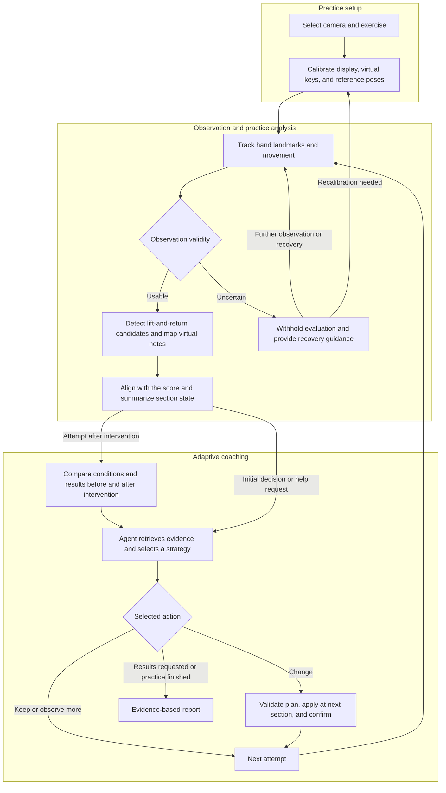

# pthoven

**Prometheus × Beethoven**

**Watch. Play. Adapt.**

**English** | [한국어](readme/README.ko.md)

[Overview](#overview) · [Why pthoven?](#why-pthoven) · [Planned Capabilities](#planned-capabilities) · [Workflow](#workflow) · [CV Design](#cv-design) · [Agent Design](#agent-design) · [RoadMap](#roadmap)

> A game-based virtual piano coach that observes finger movement through a camera and uses an agent to adapt the next practice session.

This README describes the intended service and development plan.

**Team testing:** [Run the local CV experiment lab](demo_test/experiment_web/README.md) to calibrate fingers and collect test records. The lab is separate from the planned coaching service.

## Overview

**pthoven** combines **Prometheus** and **Beethoven**. The project aims to connect **Computer Vision with a Practice Coach Agent**, using an ordinary RGB camera and finger movements on a desk to support virtual piano practice.

Users practice short melodies while watching a camera feed and virtual keys on a laptop. CV extracts finger movements and observation quality. The agent reviews difficulties in specific sections and previous attempts, then selects changes to tempo, practice range, or hints. Results under the new conditions become evidence for subsequent coaching and reports.

The central goal is to **turn practice results into changes to the next attempt**. Short missions and feedback are designed to help beginners experience playing when limited access to an instrument or a lack of experience makes starting difficult.

## Why pthoven?

### The effort required to get started

Preparing an instrument and additional input devices can be a barrier for beginners who want to try playing casually.

pthoven is designed around an iPhone Continuity Camera or a standard webcam filming the desk and hands, with virtual keys overlaid on the screen. Users can follow guidance and see their hand movements together on a laptop.

### The next action after a score

Seeing a score or a list of wrong notes does not necessarily tell a beginner which section to repeat or how much to slow down.

The Practice Coach Agent reviews recurring difficulties and the results of previous interventions, then selects the range, tempo, and guidance for the next attempt. Feedback is intended to change the actual practice settings, with the following attempt used to review the result.

### Different users need different practice conditions

Even when practicing the same piece, users may struggle with different sections and need different amounts of preparation time. Content that runs only at a fixed pace can be difficult to adapt to these differences.

pthoven plans to combine short section repeats with adjustable tempo and hints. As performance becomes more stable, coaching should guide the user back toward the original target conditions.

### Observation failures and performance mistakes

Occluded hands or interrupted video can cause a camera to miss a movement the user performed. Treating every missing input as a mistake would make feedback less reliable.

pthoven separates uncertain observation intervals from performance evaluation and requests more observation or recalibration when needed. Coaching explanations and reports preserve both the results that can be evaluated and the parts that remain unverified.

## Planned Capabilities

| Capability | Intended Behavior |
| --- | --- |
| Camera-based setup | Let users select a camera and calibrate the display orientation, virtual keys, and finger reference poses. |
| Virtual piano gameplay | Provide short melody missions with virtual keys and visual guidance over the camera feed. |
| Finger-motion input | Combine lift-and-return patterns with fingertip positions to produce candidate virtual note inputs. |
| Observation-aware evaluation | Identify occlusion, tracking loss, and timing gaps, excluding intervals that cannot be evaluated from user-error counts. |
| Adaptive practice coaching | Let the agent review evidence and history before choosing whether to keep or change the tempo, practice range, and hints. |
| Verified tool execution | Validate proposed changes, apply them at an agreed boundary, and confirm what the interface actually applied. |
| Intervention review | Compare settings and observation conditions before and after an intervention to inform the next attempt. |
| Grounded practice reports | Explain observations, uncertainty, actions actually taken, changes under recorded conditions, and the next practice step with supporting evidence. |

## Workflow

CV runs at the frame level, while the agent is triggered by events such as a section ending, recurring difficulties, or a user request. Withholding evaluation when quality deteriorates is handled independently of the model response. Setting changes are applied at understandable boundaries, such as the start of the next section.

## CV Design

### Observing finger movement in RGB video

The primary input is ordinary RGB video captured from above. The design uses MediaPipe Hand Landmarker to estimate hand landmarks and fingertip positions, then analyzes individual fingers using calibrated resting and raised poses.

| Component | Design Responsibility |
| --- | --- |
| Hand observation | Extract hand landmarks, image coordinates, observation timestamps, and tracking state. |
| Geometry and pose calibration | Align video, display, and virtual-key coordinates, and define reference poses for each finger. |
| Finger state machine | Check the temporal sequence of rest → lift → return and suppress duplicate inputs. |
| Virtual key mapping | Associate the fingertip position at the candidate event time with a virtual-key region. |
| Quality assessment | Record occlusion, uncertain hand association, invalid calibration, and timing gaps as reasons to withhold evaluation. |

A finger's identity alone does not determine a note. The same finger can correspond to different keys at different positions, so motion and spatial information are used together. Coordinate transformations must remain consistent across mirroring, display sizes, and video margins.

### Motion candidates and physical contact

The 3D coordinates estimated from a single RGB view are not precise measurements of physical height above the desk. A detected lift-and-return pattern does not verify contact, so it is treated as provisional evidence for virtual input.

Evaluation scenarios include air taps, sliding, neighboring-finger movement, and occlusion, with independently reviewed ground truth. Evaluation considers false inputs, observation coverage, and the rate of withheld inputs alongside precision and recall.

## Agent Design

### A Practice Coach using structured state

The default agent receives **section-level practice metrics, observation quality, actual settings, and previous interventions and results**, rather than raw video. When information is insufficient, it uses query tools before choosing the next practice step within the allowed scope.

Image understanding is not required for the default coaching loop. Inspecting representative frames is an optional tool, to be considered when it adds value in explaining camera placement, cropping, or occlusion.

### Tools connecting inquiry, action, and review

| Planned Tool | Purpose |
| --- | --- |
| `get_practice_state` | Inspect the snapshot and actual settings used for the current decision. |
| `get_segment_evidence` | Retrieve input, alignment, error, and withheld-evaluation evidence for a section. |
| `get_tracking_summary` | Inspect missing observations, timing gaps, and calibration issues. |
| `get_attempt_history` | Retrieve previous attempts and interventions actually applied. |
| `compare_attempts` | Examine conditions and supported metric changes between two attempts. |
| `get_reference_excerpt` | Inspect the expected score section and supported practice capabilities. |
| `set_tempo` / `set_practice_range` / `set_hint_level` | Prepare proposed changes to the tempo, repeated section, and visual guidance for the next attempt. |
| `request_recalibration` | Request a procedure to establish valid observation references again. |
| `pause_practice` / `resume_practice` / `finish_practice` | Control the practice flow according to user intent and valid preconditions. |
| `inspect_visual_context` | Optionally inspect the visual environment in representative frames. |

Calls to change tools first stage a proposal. Commands are issued only after the plan's evidence, arguments, and current state have been validated. The interface's acknowledgment is then used to confirm the actual result. A model proposal is not recorded as an applied setting change.

### A harness for evidence and execution

The harness manages model triggers, context, tool scope, execution budgets, duplicate suppression, application confirmation, failure handling, and traces. It uses metrics calculated by CV and analysis code, preventing the model from removing observation uncertainty or arbitrarily relaxing detection criteria.

After an intervention, comparisons account for practice range, tempo, hints, and input source. Better results at a slower tempo are described as changes under those conditions; improvement at the original tempo requires a separate check. Reports distinguish observations, hypotheses, actions actually taken, and recommendations.

## RoadMap

The phases below describe a development plan ordered by dependencies, without completion status or fixed dates.

| Phase | Goal | Planned Deliverable |
| --- | --- | --- |
| 1. Define contracts and scenarios | Agree on the meaning of observations, inputs, metrics, and commands, and define evaluation scope. | Shared data contracts, scenario and labeling rules, and user flows. |
| 2. Build camera interaction | Connect camera input, hand tracking, calibration, and virtual-key mapping. | Finger-motion and virtual-note inputs with observation-quality information. |
| 3. Structure practice evidence | Align inputs with the expected score and separate intervals that cannot be observed. | Practice snapshots linked to evidence, denominators, and actual settings. |
| 4. Build tools and execution control | Implement queries, staged changes, command application, confirmation, and recovery. | Tool contracts, state management, and handling of duplicates, delays, and reconnections. |
| 5. Connect adaptive coaching | Connect model-led inquiry, strategy selection, review, and report generation. | A text-based agent, intervention comparisons, and evidence-based reports. |
| 6. Evaluate and prepare the demo | Evaluate input, coaching, and UI together through real recordings and user sessions. | Failure analysis, replay evaluations, demo scenarios, and improvements. |

Models, runtimes, observation policies, and intervention criteria will be selected through controlled comparisons and user evaluation.

Detailed design documentation (Korean): [Team documentation](docs/README.md).
