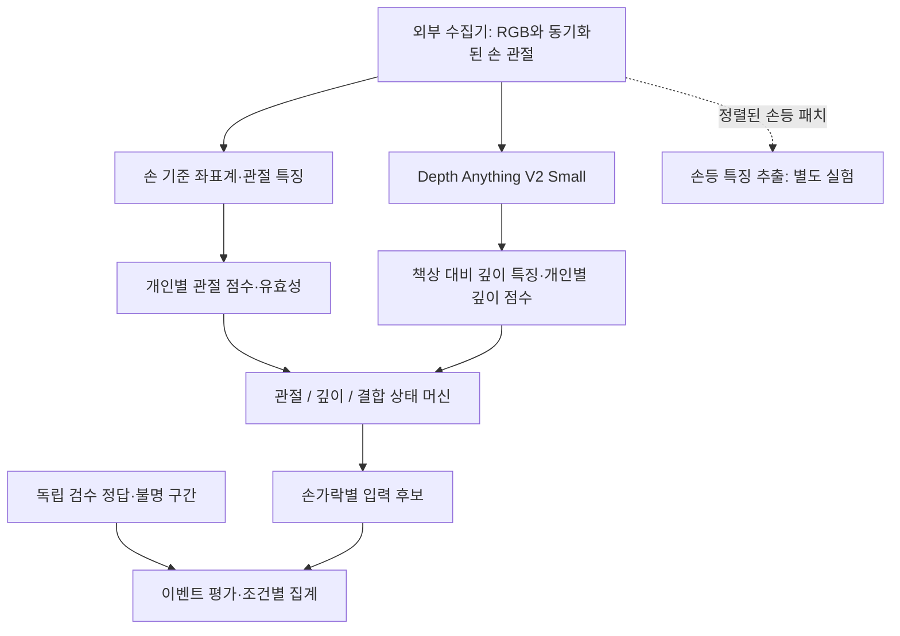

# Pthoven · 타건 탐지 실험 로직

상단 RGB 카메라에서 얻은 손 관절과 상대 깊이로 **의도적인 들림→복귀 동작 후보**를 판정하고, 어떤 신호 조합이 유효한지 비교하는 코드 모음이다.

이 폴더는 모델·수학적 특징·상태 머신·오프라인 재생·평가에 집중한다. 웹 화면, 카메라 장치 연결, HTTP 서버, 게임, Agent 코드는 포함하지 않는다. 외부 수집기가 만든 관절·영상·깊이 기록을 입력받는다.

## 포함된 실험

| 로직 | 코드 | 상세 설명 |
| --- | --- | --- |
| 손 기준 좌표계와 관절 특징 | `models/tap-detector.mjs` | [01 · 관절 특징](descriptions/01-pose-features.md) |
| 개인별 기준·들림 보정과 품질 판정 | `models/tap-detector.mjs` | [02 · 관절 보정](descriptions/02-pose-calibration.md) |
| 손가락별 들림→복귀 상태 머신 | `models/tap-detector.mjs` | [03 · 동작 주기 판정](descriptions/03-finger-state-machine.md) |
| 손등 Optical Flow·영상상 변형 | `models/skin_features.py` | [04 · 손등 특징](descriptions/04-dorsal-skin-features.md) |
| Depth Anything V2 Small 추론 | `models/depth.py` | [05 · 깊이 모델](descriptions/05-depth-inference.md) |
| 책상 대비 깊이 특징과 개인별 보정 | `models/depth.py`, `models/depth-detector.mjs` | [06 · 깊이 특징](descriptions/06-depth-signal.md) |
| 관절·깊이·가중 결합 비교 | `models/depth-detector.mjs` | [07 · 비교 실험](descriptions/07-pose-depth-comparison.md) |
| 이벤트 정렬·불명 마스크·재생·집계 | `models/*.mjs`, `scripts/*.mjs` | [08 · 평가와 재생](descriptions/08-evaluation-and-replay.md) |

[전체 설명 목차](descriptions/README.md) · [입출력 데이터 계약](descriptions/09-data-contracts.md) · [팀 설계 문서](../docs/README.md)

## 전체 흐름



핵심 출력은 `pose_tap_candidate`다. `contact_verified=false`를 유지하며, 실제 접촉·힘·mm 높이를 확인한 것으로 취급하지 않는다. MIDI 악보의 정답 음은 이 검출기에 입력하지 않는다. 검출 뒤 별도 연주 분석 단계에서 악보와 비교한다.

손등 특징은 추출기이며 타건 분류기에 결합되지 않았다. Opisthenar·Back-Hand-Pose/DorsalNet·DeltaDorsal은 참고 연구이고, 해당 논문의 신경망 재현 구현은 이 폴더에 없다. 깊이 모델은 외부 사전학습 가중치를 사용하며 자체 타건 모델 학습 결과가 아니다.

## 디렉터리

```text
demo_test/
├── models/                # 관절·깊이·피부 특징과 판정
├── scripts/               # 단일 이미지 추론, 특징 추출, 재생·평가
├── tests/                 # 해석적 관절·합성 영상에 대한 검증
├── descriptions/          # 로직별 수식·입출력·임계값·한계
├── requirements.txt       # NumPy / OpenCV
├── requirements-depth.txt # 선택: Torch / Transformers / Pillow
└── .gitignore             # 가중치·캐시·실험 데이터·출력 제외
```

## 설치와 기본 검증

Python 3.10 이상과 Node.js 20 이상을 사용한다. 다음 명령은 저장소 루트에서 시작한다.

```bash
cd demo_test
python3 -m venv .venv
source .venv/bin/activate
python -m pip install -r requirements.txt
python -m unittest discover -s tests -v
node --test tests/*.mjs
```

기본 테스트는 Depth 가중치를 다운로드하지 않는다. 테스트의 해석적 관절과 합성 패치 결과는 실제 손·카메라 정확도가 아니다.

### 관절 상태 머신의 합성 실험

```bash
node scripts/check_tap.mjs --output outputs/tap-synthetic.json
```

이상적 관절의 정상·반복·정지·이동·가림·공중 탭과 FPS·잡음·누락 조합을 검사한다. 동일 관절 궤적을 가진 공중 탭은 구분되지 않는 한계 사례도 출력한다.

### 손등 특징 추출

```bash
python scripts/make_synthetic_inputs.py
python scripts/analyze_skin.py outputs/fixtures/skin-capture.json --output outputs/skin-features.json
```

이 예시는 실제 손등이 아닌 합성 패치의 변형을 사용한다. 실제 기록은 [v1 손등 패치 형식](descriptions/09-data-contracts.md)에 맞춰 제공한다.

### 웹 없이 Depth 모델 실행

```bash
python -m pip install -r requirements-depth.txt
python scripts/make_synthetic_inputs.py
python scripts/run_depth.py outputs/fixtures/depth-request.json --output outputs/depth-result.json --preview outputs/depth-preview.jpg
```

첫 실행은 고정 revision의 모델을 `.cache/depth`에 다운로드한다. `image_path`는 요청 JSON 파일을 기준으로 해석한다. 실제 사진과 같은 프레임의 MediaPipe 21개 정규화 좌표, 책상 기준점 3~8개를 제공하면 같은 CLI로 분석할 수 있다. 이미지가 합성인지 실촬영인지 출처를 명시한다. 단일 이미지 추론은 타건 주기·실제 접촉 정확도 평가가 아니다.

환경 변수:

| 변수 | 의미 |
| --- | --- |
| `PTOVEN_DEPTH_CACHE` | 모델 캐시 경로 변경 |
| `PTOVEN_DEPTH_DEVICE=cpu` | CPU 실행 |
| `PTOVEN_DEPTH_DEVICE=mps` | Apple GPU 명시 |
| `PTOVEN_DEPTH_DEVICE=cuda` | CUDA 장치 명시 |

자동 선택은 MPS 사용 가능 시 MPS, 나머지는 CPU다. CUDA는 명시해야 한다. 자세한 로딩·추론 계약은 [05](descriptions/05-depth-inference.md)를 참고한다.

### 관절·깊이 비교 기록 재생과 평가

```bash
node scripts/make_depth_fixture.mjs outputs/depth-fixture.json
node scripts/replay_depth.mjs outputs/depth-fixture.json > outputs/depth-replay.json
node scripts/evaluate_depth.mjs outputs/depth-fixture.json > outputs/depth-evaluation.json
```

합성 예제의 `truth=null`이므로 F1은 비워둔다. 실제 기록은 같은 [v2 데이터 계약](descriptions/09-data-contracts.md)을 사용한다.

```bash
node scripts/replay_depth.mjs data/capture.json > outputs/replay.json
node scripts/evaluate_depth.mjs data/person1.json data/person2.json > outputs/evaluation.json
```

개발/평가, 시나리오, 설정별 집계와 사용자 중복 여부를 확인한다. 미관측 평가에서 F1·공중 탭 오입력·관측률·지연을 함께 확인한 뒤 방식을 선택한다. 평가용 라벨로 임계값을 튜닝하지 않는다.

## 외부 모델과 출처

- 손 관절 입력: [MediaPipe Hand Landmarker](https://developers.google.com/edge/mediapipe/solutions/vision/hand_landmarker). 이 폴더에서는 좌표를 받아 처리하며 카메라·MediaPipe 실행기를 배포하지 않는다.
- 깊이 모델: [Depth Anything V2 Small](https://huggingface.co/depth-anything/Depth-Anything-V2-Small-hf), revision `5426e4f0f36572d16453bbda7a8389317b1bef99`. 모델 카드의 Apache-2.0 표기를 참고한다. 가중치를 이 저장소에 재배포하지 않는다.
- 손등 특징: [OpenCV Optical Flow](https://docs.opencv.org/4.x/d4/dee/tutorial_optical_flow.html)의 Farneback 구현을 사용한다.

학습 데이터·촬영 영상·모델 캐시·추론 결과는 커밋 대상에서 제외한다. 상세 방법과 아직 확인하지 못한 범위는 각 description에 분리해 적었다.
