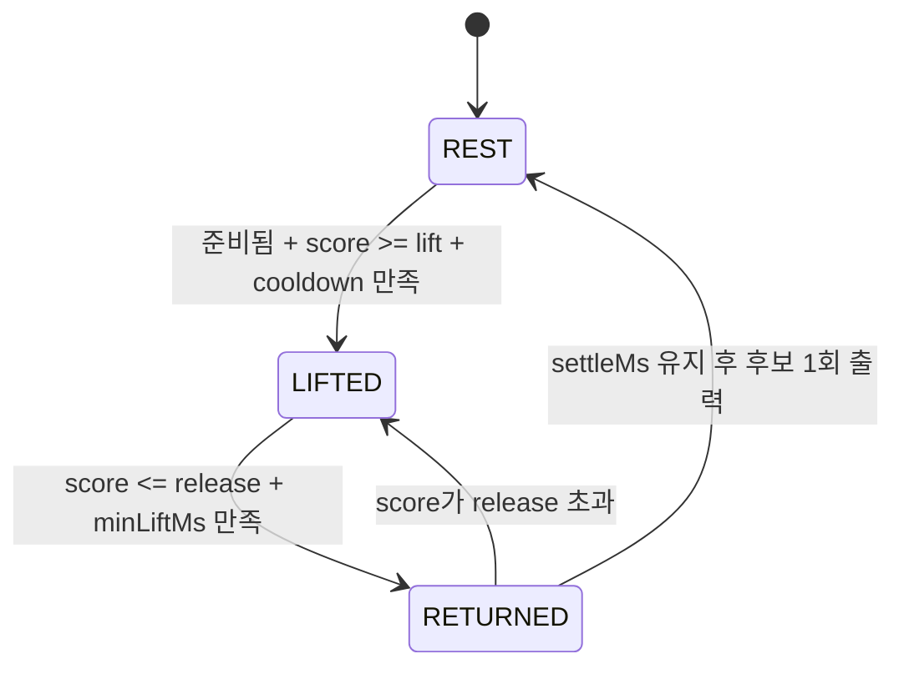

# 03 · 손가락별 들림→복귀 상태 머신

[목차](README.md) · [코드: TapMachine](../models/tap-detector.mjs)

## 판정하려는 것

손가락이 기준 자세에 놓여 있다는 한 프레임만으로 입력을 만들지 않는다. **기준 관측 → 충분한 들림 → 기준 부근 복귀 → 짧은 유지**라는 시간 순서가 있어야 타건 후보를 출력한다.

이 상태 머신은 관절·깊이·결합 점수에 공통으로 사용한다. 손가락마다 별도 인스턴스가 있어 이웃 손가락의 상태와 분리된다.

## 입력

`update(t, score, valid=true)`에 단조 증가하는 밀리초 시각과 보정된 스칼라 점수를 전달한다. 프레임 번호를 시각으로 대체하면 FPS가 바뀔 때 의미가 달라진다.

초기 상태와 추적 손실 이후에는 낮은 점수를 다시 관측해 `ready`가 되어야 한다. 첫 관측은 이전 시각이 없어 초기화에 사용되므로, 기준 자세를 여러 프레임 관측한 뒤 동작한다.

## 상태 전이



- `REST`: 다음 들림 대기.
- `LIFTED`: 충분한 변화가 발생한 상태. 관측한 peak를 저장한다.
- `RETURNED`: 기준 부근으로 돌아온 시각을 저장하고 유지 여부를 확인한다.
- 유효하지 않은 관측·긴 프레임 공백은 주기를 지우고 재준비를 요구한다.

들림과 복귀 임계값을 다르게 쓰는 히스테리시스로 경계 부근의 흔들림을 줄인다. 반환 후 계속 손가락을 놓고 있으면 새로운 들림이 없으므로 이벤트가 반복되지 않는다.

## 기본 파라미터

| 이름 | 기본값 | 역할 |
| --- | --- | --- |
| `lift` | 0.55 | 들림 진입 임계값 |
| `release` | 0.20 | 기준 부근 복귀 임계값 |
| `minLiftMs` | 40ms | 너무 짧은 들림 스파이크 제외 |
| `settleMs` | 30ms | 복귀 상태 유지 시간 |
| `cooldownMs` | 90ms | 직전 이벤트 뒤 새 들림 진입 제한 |
| `maxGapMs` | 150ms | 허용 관측 공백. 저속 비교 경로는 600ms |
| `maxCycleMs` | 1800ms | 길게 이어지는 미완성 주기 초기화 |

최적값이 아니라 초기 비교 설정이다. 특히 프레임 공백과 확인 시간은 느린 깊이 추론에서 누락·지연을 만들 수 있다.

## 출력 시각의 의미

```json
{
  "kind": "pose_tap_candidate",
  "t_ms": 400,
  "emitted_ms": 450,
  "latency_ms": 50,
  "peak": 1.0,
  "contact_verified": false
}
```

예시의 `t_ms`는 RETURNED에 진입한 관측 시각이다. `emitted_ms`는 유지 조건까지 확인해 결과를 내보낸 시각이다. 이 차이는 **후보 확인 지연**이며 실제 접촉 대비 지연이 아니다. 깊이 비교 경로는 처리 응답을 받은 시각까지 포함하도록 emitted_ms를 갱신한다.

유효하지 않은 입력은 이벤트 대신 null을 반환한다. 중복·역행 시각은 예외다. `peak`는 동작 점수의 최대값이며 누르는 힘이나 신뢰 확률이 아니다.

## 검증 사례와 한계

정지·잡음, 1회/반복 탭, 짧은 스파이크, 들림 없는 복귀, 추적 누락, 긴 공백, 다중 손가락을 테스트한다.

**같은 관절·깊이 관측을 만드는 실제 탭과 공중 탭은 구분할 수 없다.** 상태 전이는 영상에 없는 접촉 정보를 복원하지 않는다. `maxCycleMs`는 오래된 주기를 초기화하는 장치이며, 모든 비정상 자세를 차단하는 규칙은 아니다. 정확도 비교에는 독립 라벨과 공중 탭 조건이 필요하다.
