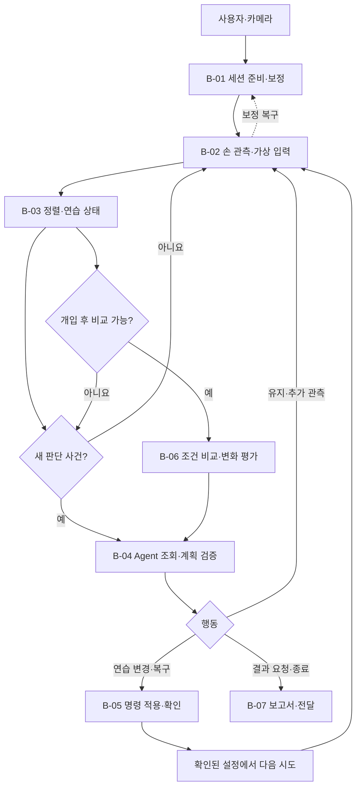

# Overall Plan · 프토벤 CV–Agent 서비스 설계

[문서 안내](README.md) · [Big Node](02-big-nodes/README.md) · [Small Node](03-small-nodes/README.md) · [Tool](04-tools/README.md)

## 1. 해결하려는 문제

입문자는 음을 찾고, 타이밍을 맞추고, 자신의 어려움을 파악하는 일을 동시에 수행하기 어렵다. 점수와 틀린 음만 알려주면 다음에 어떤 속도로 어느 구간을 연습할지도 불분명하다.

프토벤은 악기 없이 짧게 경험할 수 있는 가상 피아노 게임을 제공하고, 관측 가능한 어려움에 따라 연습 구간·템포·가이드를 바꾸는 코칭 루프를 구성한다. 전문적인 타건 교정이나 실제 건반의 무게감 재현을 제품의 필수 목표로 두지 않는다.

## 2. 사용자 경험

`카메라 선택 → 화면 방향·가상 건반 확인 → 기준 보정 → 짧은 연습 → 근거 조회·코치 선택 → 다음 구간 적용 → 재도전 → 조건을 포함한 비교·보고서`

- 사용자는 화면에서 다음 입력과 코치의 짧은 안내를 확인한다.
- 관측 품질이 나쁘면 연주 실수로 판정하기 전에 평가 보류와 복구 안내를 받는다.
- Agent의 제안, 적용 대기, 실제 적용, 재평가를 구분해 표시한다.
- 한 번 더 연습할 수 없는 데모 상황은 출처를 명시한 저장 세션 재생으로 별도 보여준다.

## 3. 설계 계층

| 계층 | 이름 | 의미 |
| --- | --- | --- |
| 전체 | Practice Loop | 관측에서 연습 개입·재평가까지 이어지는 서비스 |
| 상위 단계 | Big Node, B-01~B-07 | 목적별 세부 실행·분기를 관리하는 워크플로 |
| 세부 단계 | Small Node, S-01~S-19 | 입출력과 단일 책임이 구분되는 처리 단위 |
| 모델 호출 인터페이스 | Tool, T-01~T-14 | Agent가 조회하거나 변경을 제안하는 인터페이스 |
| 내부 기능 | 함수·연산 | 각 단계의 보조 처리. 별도 노드 계층 없음 |
| 공통 실행 | Harness | 상태·예산·도구·명령·실패·로그·평가 관리 |

프레임 처리, 오류 계산, 명령 검증은 결정론적 코드가 담당한다. LLM은 필요한 정보를 조회하고 허용된 연습 전략을 선택한다. 라이브러리 선택과 이 계층 구분은 독립적이다.

## 4. 전체 흐름

B-02는 새 프레임마다 실행되는 관측 루프이고 B-03은 구간·관측 창 경계에서 상태를 집계한다. B-04의 응답이 진행 중인 프레임 처리를 막지 않게 한다. B-01의 기준 수집에서도 동일한 손 관측 세부 단계를 재사용한다.

상위 흐름이 다음 세부 단계를 정한다. 조건 분기나 대기 박스를 모두 새로운 Small Node로 만들지 않는다.

## 5. 상위 단계별 목적

| 단계 | 목적 | 상세 문서 |
| --- | --- | --- |
| B-01 | 사용자가 사용할 영상·입력·가상 건반·손가락 기준을 일관된 세션으로 준비한다. | [세션 준비와 보정](02-big-nodes/B-01.md) |
| B-02 | RGB 손 관측을 품질이 표시된 가상 음 입력으로 변환한다. | [실시간 관측과 가상 연주 입력](02-big-nodes/B-02.md) |
| B-03 | 가상 입력의 오류·타이밍과 관측 불확실성을 분리해 코치 근거를 만든다. | [연주 분석과 상태 집계](02-big-nodes/B-03.md) |
| B-04 | 사건별 근거를 조회하여 다음 연습의 유지·관측·보정·변경을 선택한다. | [Agent 정보 조회와 연습 계획](02-big-nodes/B-04.md) |
| B-05 | 검증된 계획을 사용자 경험을 해치지 않는 시점에 실제 반영하고 결과를 확인한다. | [연습 변경 실행과 확인](02-big-nodes/B-05.md) |
| B-06 | 조건을 명시한 전후 비교를 만들어 Agent가 개입을 유지·완화·복귀할 근거를 제공한다. | [개입 결과 비교와 다음 판단](02-big-nodes/B-06.md) |
| B-07 | 관측·제한·실제 조치·변화·다음 연습을 검증 가능한 보고서로 전달한다. | [근거 기반 보고서와 전달](02-big-nodes/B-07.md) |

## 6. CV와 Agent의 정보 교환

CV는 관절과 이미지 좌표, 동작 후보, 관측 유효 구간을 제공한다. 분석은 이를 가상 건반과 기대 악보에 연결해 분모·출처가 있는 지표를 만든다. Agent는 지표·실제 설정·최근 개입·불확실성만 우선 받는다.

Agent가 추가 근거를 원하면 구간·품질·이력·비교 도구를 조회한다. 변경 도구는 제안을 stage하고 최종 계획 검증 뒤 실제 설정에 반영한다. 다음 시도 결과는 다시 같은 분석 계약을 통해 돌아온다.

### 하지 않는 추론

- 들림·복귀 후보를 실제 책상 접촉 정답으로 바꾸지 않는다.
- 기대 악보 음으로 관측 음을 채우지 않는다.
- 손 가림의 무입력을 사용자 실수로 확정하지 않는다.
- 점수 상승만으로 피아노 능력 향상이나 개입의 인과 효과를 단정하지 않는다.
- 음 길이·힘·피로 등 관측하지 않은 특성을 생성하지 않는다.

## 7. 실행·판단·전달의 시간 분리

| 구분 | 시점 | 담당 |
| --- | --- | --- |
| 영상·손 관측 | 새 프레임마다 | CV·웹 |
| 동작·음 매핑 | 유효한 관측마다 | 상태 머신·게임 입력 |
| 연습 상태 | 구간 또는 관측 창 종료 | 분석 |
| 코치 판단 | 사건 발생·중복 억제 후 | 텍스트 Agent |
| 설정 변경 | 다음 구간·정지 상태 등 명시한 경계 | 명령 실행 계층 |
| 비교·보고 | 개입 후 구간 종료·결과 요청 | 분석·Agent·검증·UI |

품질 악화 시 입력 평가 보류는 시스템이 즉시 수행한다. 모델 응답을 기다려 잘못된 점수를 계속 계산하지 않는다.

## 8. 이미지 이해 모델의 위치

오류 구간, 반복 횟수, 템포, 힌트, 전후 비교는 구조화 데이터로 판단한다. 기본 Agent에 이미지 입력은 필요하지 않다.

선택 도구 T-14는 지표만으로 설명하기 어려운 화면 잘림·가림·배치를 대표 프레임으로 점검한다. 시각 설명은 보조 가설이며 접촉·압력·정답을 덮어쓰지 않는다. 보고서의 이미지·그래프는 렌더러가 만들 수 있다.

## 9. 협업 경계와 전달물

| 담당 | 소유할 계약·산출물 | 협업 대상 |
| --- | --- | --- |
| CV | Observation·Quality·TapCandidate·보정 정의 | 웹 좌표·분석 제외 구간 |
| 웹·게임 | 표시 변환·가상 건반·명령 적용·ACK | CV·서버·디자인 |
| 분석·서버 | 정렬·지표·스냅샷·시도·명령 기록 | CV·Agent |
| Agent | 컨텍스트·조회·계획·도구 선택·설명 | 서버 검증·평가 |
| 디자인 | 상태 구분·보정 안내·다음 연습·보고서 구조 | 웹·Agent |
| 평가 | 독립 라벨·재생 시나리오·전략 평가 | 모든 담당 |

의존성 기준 작업 순서는 `공통 계약 → 관측·매핑과 명령 적용 경로 → 품질 기반 상태 → 도구·텍스트 Agent → 전후 비교·보고서 → 현장 평가·선택 확장`이다. 일정·구현 진척은 별도 운영 자료에서 관리한다.

## 10. 문서 간 연결

- 상위 분기: [Big Node](02-big-nodes/README.md)
- 함수·입출력: [Small Node](03-small-nodes/README.md)
- Agent 호출 계약: [Tool](04-tools/README.md)
- 상태·시간·명령: [공통 계약](05-contracts/README.md)
- 예산·기록·평가·데모: [하네스](06-harness-and-evaluation.md)
- 팀 합의가 필요한 값·제품 범위: [결정 항목](07-decision-points.md)
