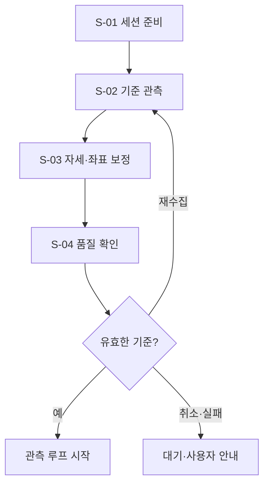

# B-01 · 세션 준비와 보정

[전체 계획](../01-overall-plan.md) · [상위 단계 목록](README.md)

## 1. 목적과 입출력

사용자가 사용할 영상·입력·가상 건반·손가락 기준을 일관된 세션으로 준비한다.

- 입력: `SessionStartRequest, SessionPolicy, DisplayGeometry`
- 출력: `SessionContext + CalibrationBundle + QualityAssessment`
- 이 문서의 책임: 세부 단계 호출 순서·조건부 분기·반복·종료 기준.

## 2. 실행 흐름

이 다이어그램의 `S-xx`만 Small Node다. 조건 마름모와 대기·결과 박스는 별도 노드 계층으로 세지 않는다. 다음 단계를 선택하는 주체는 상위 흐름과 하네스이며, Small Node가 다른 Small Node를 직접 호출하지 않는다.

## 3. 세부 단계와 산출물

| 순서 | Small Node | 단일 책임 | 산출물 |
| --- | --- | --- | --- |
| 1 | [S-01 · prepare_session](../03-small-nodes/S-01.md) | 사용자가 선택한 장치·입력 모드·연습곡을 하나의 세션 범위와 초기 설정으로 고정한다. | SessionContext |
| 2 | [S-02 · estimate_hand_observation](../03-small-nodes/S-02.md) | 새 RGB 프레임을 손 관절·이미지 좌표·관측 시각·추적 진단으로 변환한다. | ObservationBatch |
| 3 | [S-03 · calibrate_geometry_and_pose](../03-small-nodes/S-03.md) | 표시 좌표 변환과 기준·들림 자세를 검증하여 버전이 있는 CalibrationBundle을 만든다. | CalibrationBundle |
| 4 | [S-04 · assess_observation_quality](../03-small-nodes/S-04.md) | 영상·손 연결·보정·시간 공백을 평가하여 사용할 구간과 unknown 구간을 분리한다. | QualityAssessment |

## 4. 분기와 중단·복구

| 조건 | 처리 |
| --- | --- |
| 권한·장치 응답 대기 | 평가 시작 없이 프리뷰·도움말 상태 유지 |
| 자세 차이·샘플 부족 | 예산·사용자 의사 안에서 재수집 |
| 좌표·자세 기준 유효 | 보정·기하 버전으로 이후 입력 연결 |
| 카메라·손 선택 변경 | 관련 기준·진행 주기·대기 명령 무효화 |

재시도는 [하네스·평가 계획](../06-harness-and-evaluation.md)의 공통 예산 안에서 수행한다. 사용자 취소, 세션 종료, 제어 epoch 변경을 무시하고 이전 작업을 계속하지 않는다.

## 5. 보존할 불변 조건

- 보정 요청을 보정 완료로 취급하지 않는다.
- 영상과 건반은 같은 화면 변환을 사용한다.
- 사용자가 선택한 장치를 다른 장치로 몰래 대체하지 않는다.

## 6. 사용자 경험 예시

사용자가 오른손 검지를 선택하고 기준·들림 자세를 수집한다. 자세 차이가 부족하면 재수집을 안내하고, 유효한 기준이 발급되면 손가락 입력을 준비한다.

UI의 표현과 서버 실행 상태가 일치하도록 관측·선택·적용 대기·적용 확인·재평가를 구분한다.

## 7. 확인할 시나리오

- 반전·리사이즈·장치 변경 시 무효화 범위가 명확하다.
- 영상·추론·손 감지·보정을 별도 상태로 표시한다.

세부 실패·입출력·함수 검증은 연결된 Small Node 계약을 기준으로 확인한다. 이 목록은 계획의 수용 기준이며 개발 진척을 표시하지 않는다.
