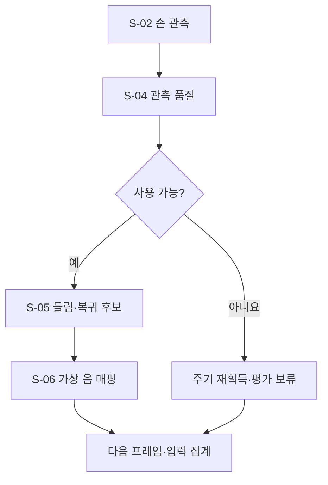

# B-02 · 실시간 관측과 가상 연주 입력

[전체 계획](../01-overall-plan.md) · [상위 단계 목록](README.md)

## 1. 목적과 입출력

RGB 손 관측을 품질이 표시된 가상 음 입력으로 변환한다.

- 입력: `FramePacket stream, SessionContext, CalibrationBundle`
- 출력: `VirtualInputBatch + QualityAssessment + ObservationBuffer`
- 이 문서의 책임: 세부 단계 호출 순서·조건부 분기·반복·종료 기준.

## 2. 실행 흐름

이 다이어그램의 `S-xx`만 Small Node다. 조건 마름모와 대기·결과 박스는 별도 노드 계층으로 세지 않는다. 다음 단계를 선택하는 주체는 상위 흐름과 하네스이며, Small Node가 다른 Small Node를 직접 호출하지 않는다.

## 3. 세부 단계와 산출물

| 순서 | Small Node | 단일 책임 | 산출물 |
| --- | --- | --- | --- |
| 1 | [S-02 · estimate_hand_observation](../03-small-nodes/S-02.md) | 새 RGB 프레임을 손 관절·이미지 좌표·관측 시각·추적 진단으로 변환한다. | ObservationBatch |
| 2 | [S-04 · assess_observation_quality](../03-small-nodes/S-04.md) | 영상·손 연결·보정·시간 공백을 평가하여 사용할 구간과 unknown 구간을 분리한다. | QualityAssessment |
| 3 | [S-05 · detect_finger_cycle](../03-small-nodes/S-05.md) | 관절 특징의 시간 변화를 사용하여 손가락별 pose_tap_candidate를 중복 없이 만든다. | TapCandidateBatch |
| 4 | [S-06 · map_virtual_note](../03-small-nodes/S-06.md) | 주기 후보 시각의 손끝 위치를 가상 건반에 매핑하고 수용·보류된 가상 음 이벤트를 생성한다. | VirtualInputBatch |

## 4. 분기와 중단·복구

| 조건 | 처리 |
| --- | --- |
| 추론 정상·손 없음 | no_hand와 unknown 구간 기록 |
| 관측 손실·프레임 중단 | 진행 중 주기 폐기·품질 보류 사건 발행 |
| 들림·복귀 없음 | 정상 no_cycle, 오류 아님 |
| 건반 경계·좌표 없음 | 음 매핑 보류, 기대 음 대체 금지 |

재시도는 [하네스·평가 계획](../06-harness-and-evaluation.md)의 공통 예산 안에서 수행한다. 사용자 취소, 세션 종료, 제어 epoch 변경을 무시하고 이전 작업을 계속하지 않는다.

## 5. 보존할 불변 조건

- LLM을 매 프레임 호출하지 않는다.
- 가상 입력 수용과 실제 접촉 확인을 구분한다.
- 손가락 이름만으로 음을 정하지 않는다.

## 6. 사용자 경험 예시

검지가 들렸다가 돌아오면 후보 시각의 손끝 좌표를 가상 미 건반에 연결한다. 건반 경계라면 음을 확정하지 않고 보류한다.

UI의 표현과 서버 실행 상태가 일치하도록 관측·선택·적용 대기·적용 확인·재평가를 구분한다.

## 7. 확인할 시나리오

- 정지·반복·끌기·공중 탭·가림에서 후보와 보류 근거가 남는다.
- 서버 도착 시각을 입력 시각으로 사용하지 않는다.

세부 실패·입출력·함수 검증은 연결된 Small Node 계약을 기준으로 확인한다. 이 목록은 계획의 수용 기준이며 개발 진척을 표시하지 않는다.
