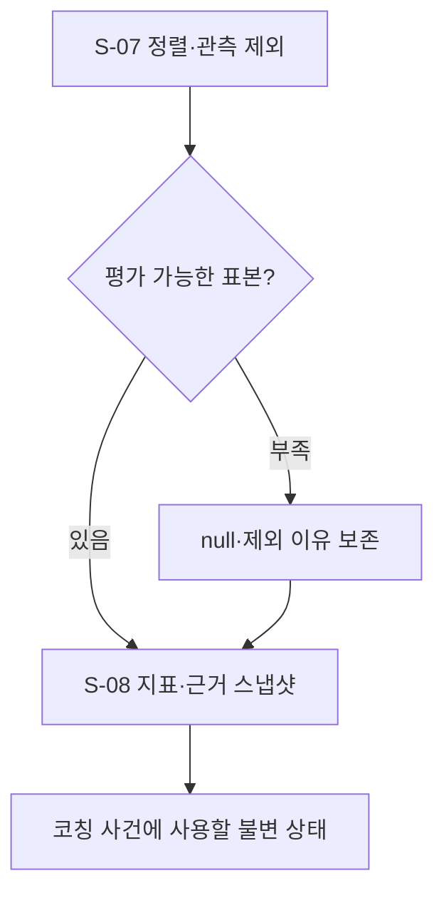

# B-03 · 연주 분석과 상태 집계

[전체 계획](../01-overall-plan.md) · [상위 단계 목록](README.md)

## 1. 목적과 입출력

가상 입력의 오류·타이밍과 관측 불확실성을 분리해 코치 근거를 만든다.

- 입력: `VirtualInputBatch, QualityAssessment, ExerciseExcerpt, AppliedPracticeConfig`
- 출력: `AlignmentResult + PracticeSnapshot`
- 이 문서의 책임: 세부 단계 호출 순서·조건부 분기·반복·종료 기준.

## 2. 실행 흐름

이 다이어그램의 `S-xx`만 Small Node다. 조건 마름모와 대기·결과 박스는 별도 노드 계층으로 세지 않는다. 다음 단계를 선택하는 주체는 상위 흐름과 하네스이며, Small Node가 다른 Small Node를 직접 호출하지 않는다.

## 3. 세부 단계와 산출물

| 순서 | Small Node | 단일 책임 | 산출물 |
| --- | --- | --- | --- |
| 1 | [S-07 · align_practice_events](../03-small-nodes/S-07.md) | 가상 입력과 기대 음을 정렬하되 관측 불가 구간을 사용자 오류에서 분리한다. | AlignmentResult |
| 2 | [S-08 · build_practice_snapshot](../03-small-nodes/S-08.md) | 정렬·품질·실제 설정·이력을 결합해 코칭이 참조할 불변 스냅샷을 생성한다. | PracticeSnapshot |

## 4. 분기와 중단·복구

| 조건 | 처리 |
| --- | --- |
| 정렬 가능한 유효 입력 | 분모·표본·근거를 갖춘 지표 계산 |
| unknown 구간에 기대 음 존재 | 해당 음 평가 제외, 누락 오류와 분리 |
| 타이밍·음 길이 정의 부족 | 해당 지표 null과 이유 반환 |
| 서로 다른 입력 출처 | 지표와 비교 범위 분리 |

재시도는 [하네스·평가 계획](../06-harness-and-evaluation.md)의 공통 예산 안에서 수행한다. 사용자 취소, 세션 종료, 제어 epoch 변경을 무시하고 이전 작업을 계속하지 않는다.

## 5. 보존할 불변 조건

- 수치는 코드가 계산한다.
- 관측되지 않은 입력을 사용자 실수로 단정하지 않는다.
- 실제 적용 설정만 기준 조건으로 기록한다.

## 6. 사용자 경험 예시

8개 기대 음 중 2개가 가림 구간에 있다면 2개는 평가 제외하고 나머지 6개에 대한 결과를 표시한다. 제외 사실을 점수 뒤에 숨기지 않는다.

UI의 표현과 서버 실행 상태가 일치하도록 관측·선택·적용 대기·적용 확인·재평가를 구분한다.

## 7. 확인할 시나리오

- unknown·미라벨·진짜 무입력이 구분된다.
- 지표의 표본 수와 단위가 근거까지 추적된다.

세부 실패·입출력·함수 검증은 연결된 Small Node 계약을 기준으로 확인한다. 이 목록은 계획의 수용 기준이며 개발 진척을 표시하지 않는다.
