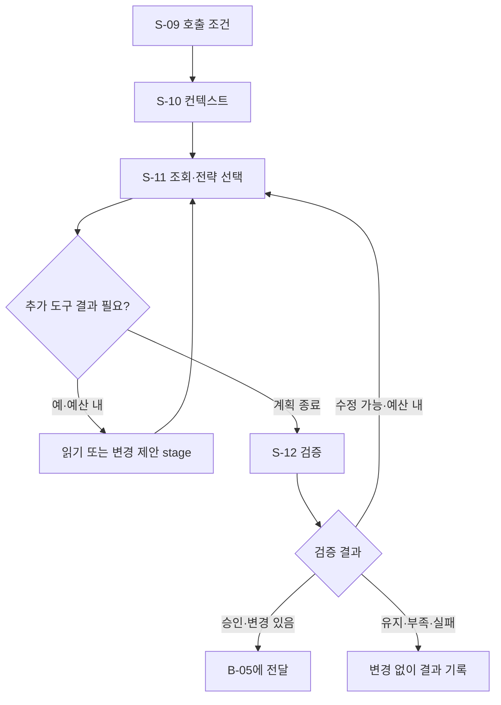

# B-04 · Agent 정보 조회와 연습 계획

[전체 계획](../01-overall-plan.md) · [상위 단계 목록](README.md)

## 1. 목적과 입출력

사건별 근거를 조회하여 다음 연습의 유지·관측·보정·변경을 선택한다.

- 입력: `CoachingTrigger, PracticeSnapshot, SessionHistory, ToolRegistry`
- 출력: `ValidatedPlan 또는 설명 가능한 보류·유지 결과`
- 이 문서의 책임: 세부 단계 호출 순서·조건부 분기·반복·종료 기준.

## 2. 실행 흐름

이 다이어그램의 `S-xx`만 Small Node다. 조건 마름모와 대기·결과 박스는 별도 노드 계층으로 세지 않는다. 다음 단계를 선택하는 주체는 상위 흐름과 하네스이며, Small Node가 다른 Small Node를 직접 호출하지 않는다.

## 3. 세부 단계와 산출물

| 순서 | Small Node | 단일 책임 | 산출물 |
| --- | --- | --- | --- |
| 1 | [S-09 · route_coaching_trigger](../03-small-nodes/S-09.md) | 사용자 요청·구간 종료·품질 악화·재평가 사건을 중복 없이 적절한 코칭 요청으로 변환한다. | CoachRequest |
| 2 | [S-10 · build_coach_context](../03-small-nodes/S-10.md) | 현재 목적에 필요한 스냅샷·최근 개입·허용 도구만 포함한 모델 입력을 구성한다. | CoachContext |
| 3 | [S-11 · decide_practice_strategy](../03-small-nodes/S-11.md) | 필요한 근거를 조회하고 변경 제안을 준비하여 한 번의 코칭 계획을 생성한다. | CoachPlan |
| 4 | [S-12 · validate_coach_plan](../03-small-nodes/S-12.md) | 계획 형식·근거·도구 범위·현재 상태를 검사하고 실행 가능한 변경 묶음을 확정한다. | ValidatedPlan |

## 4. 분기와 중단·복구

| 조건 | 처리 |
| --- | --- |
| 품질 악화 | 시스템 평가 보류 우선, Agent는 관측 조회·복구 계획 선택 |
| 새 근거 없음·중복 사건 | 모델 재호출 억제 |
| 근거 부족 | 추가 조회 또는 관측 유지 |
| 계획 오래됨·범위 위반 | 제한된 재판단 또는 거절 |
| 모델 장애 | 실제 확인 설정 유지·규칙 대체 출처 표시 |
| 계획이 유지·추가 관측이고 변경 묶음이 비어 있음 | B-05 명령 발행 없이 관측 루프로 복귀 |

재시도는 [하네스·평가 계획](../06-harness-and-evaluation.md)의 공통 예산 안에서 수행한다. 사용자 취소, 세션 종료, 제어 epoch 변경을 무시하고 이전 작업을 계속하지 않는다.

## 5. 보존할 불변 조건

- 변경 도구 호출은 이 단계에서 실제 UI를 바꾸지 않는다.
- 모델이 관측 정책을 완화하거나 접촉 확인 속성을 바꾸지 못한다.
- 조회·추론·수정은 공통 시간·토큰·호출 예산 안에서 수행한다.

## 6. 사용자 경험 예시

오류가 반복되면 Agent가 해당 구간 근거와 이전 시도를 조회한다. 품질은 안정적이고 같은 구간의 어려움이 반복될 때 낮은 템포 연습을 제안한다.

UI의 표현과 서버 실행 상태가 일치하도록 관측·선택·적용 대기·적용 확인·재평가를 구분한다.

## 7. 확인할 시나리오

- 조회 결과에 따라 다른 행동을 고를 수 있다.
- 보고서 생성만 한 흐름과 도구를 선택·실행한 흐름을 구별할 수 있다.

세부 실패·입출력·함수 검증은 연결된 Small Node 계약을 기준으로 확인한다. 이 목록은 계획의 수용 기준이며 개발 진척을 표시하지 않는다.
