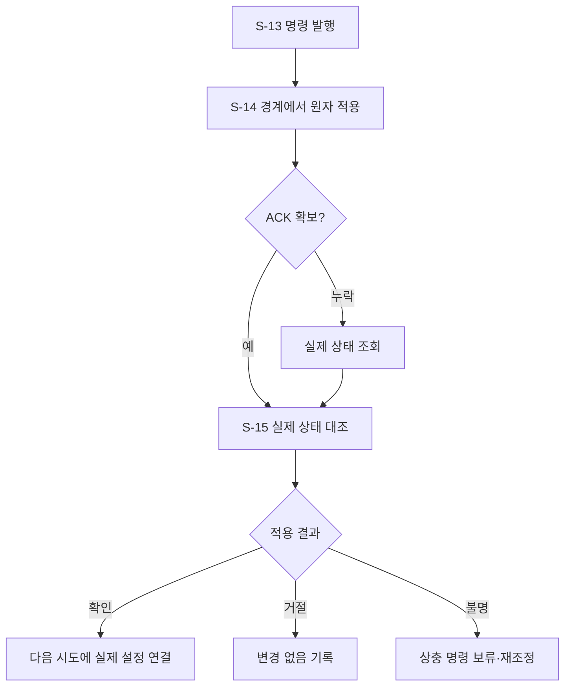

# B-05 · 연습 변경 실행과 확인

[전체 계획](../01-overall-plan.md) · [상위 단계 목록](README.md)

## 1. 목적과 입출력

검증된 계획을 사용자 경험을 해치지 않는 시점에 실제 반영하고 결과를 확인한다.

- 입력: `ValidatedPlan, ClientControlState, CommandJournal`
- 출력: `InterventionRecord + 확인된 실제 설정`
- 이 문서의 책임: 세부 단계 호출 순서·조건부 분기·반복·종료 기준.

## 2. 실행 흐름

이 다이어그램의 `S-xx`만 Small Node다. 조건 마름모와 대기·결과 박스는 별도 노드 계층으로 세지 않는다. 다음 단계를 선택하는 주체는 상위 흐름과 하네스이며, Small Node가 다른 Small Node를 직접 호출하지 않는다.

## 3. 세부 단계와 산출물

| 순서 | Small Node | 단일 책임 | 산출물 |
| --- | --- | --- | --- |
| 1 | [S-13 · issue_practice_command](../03-small-nodes/S-13.md) | 검증된 변경 묶음을 한 번만 발행하고 적용을 기다리는 실행 기록을 만든다. | CommandTicket |
| 2 | [S-14 · apply_command_and_ack](../03-small-nodes/S-14.md) | 약속한 경계에서 명령을 검증·원자 적용하고 실제 값이 담긴 ACK를 반환한다. | ApplicationAck |
| 3 | [S-15 · reconcile_intervention](../03-small-nodes/S-15.md) | ACK 또는 클라이언트 실제 상태를 대조해 개입 기록을 확정하거나 불명 상태로 보존한다. | InterventionRecord |

## 4. 분기와 중단·복구

| 조건 | 처리 |
| --- | --- |
| 다음 구간 대기 | queued 상태, 사용자에게 적용 전임을 표시 |
| 동일 명령 재전송 | 원래 결과 반환, 중복 적용 금지 |
| epoch·설정·보정 변경 | 오래된 명령 거절 |
| ACK 누락 | 미적용으로 단정하지 않고 실제 상태 조회 |

재시도는 [하네스·평가 계획](../06-harness-and-evaluation.md)의 공통 예산 안에서 수행한다. 사용자 취소, 세션 종료, 제어 epoch 변경을 무시하고 이전 작업을 계속하지 않는다.

## 5. 보존할 불변 조건

- 한 change_set은 전체 적용 또는 변경 없음이다.
- 발행·제안·화면 적용을 다른 상태로 기록한다.
- 사용자의 수동 정지·종료가 Agent 변경보다 우선한다.

## 6. 사용자 경험 예시

템포 60 BPM과 한 구간 반복을 묶어 다음 시작에 적용한다. 웹이 실제 적용값을 ACK로 보내면 서버가 개입을 confirmed로 기록한다.

UI의 표현과 서버 실행 상태가 일치하도록 관측·선택·적용 대기·적용 확인·재평가를 구분한다.

## 7. 확인할 시나리오

- 늦은 응답·재연결·재전송에 잘못된 설정이 적용되지 않는다.
- 실제 적용되지 않은 설정을 보고서·비교 기준으로 쓰지 않는다.

세부 실패·입출력·함수 검증은 연결된 Small Node 계약을 기준으로 확인한다. 이 목록은 계획의 수용 기준이며 개발 진척을 표시하지 않는다.
