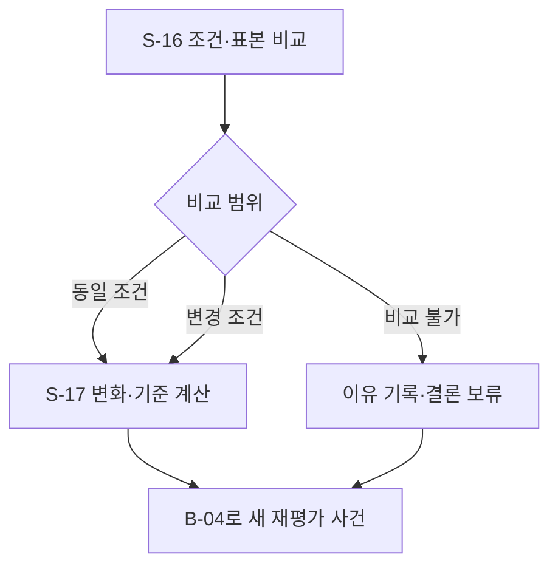

# B-06 · 개입 결과 비교와 다음 판단

[전체 계획](../01-overall-plan.md) · [상위 단계 목록](README.md)

## 1. 목적과 입출력

조건을 명시한 전후 비교를 만들어 Agent가 개입을 유지·완화·복귀할 근거를 제공한다.

- 입력: `전후 PracticeSnapshot, InterventionRecord, ComparisonPolicy`
- 출력: `ComparabilityReport + InterventionComparison + 재평가 사건`
- 이 문서의 책임: 세부 단계 호출 순서·조건부 분기·반복·종료 기준.

## 2. 실행 흐름

이 다이어그램의 `S-xx`만 Small Node다. 조건 마름모와 대기·결과 박스는 별도 노드 계층으로 세지 않는다. 다음 단계를 선택하는 주체는 상위 흐름과 하네스이며, Small Node가 다른 Small Node를 직접 호출하지 않는다.

## 3. 세부 단계와 산출물

| 순서 | Small Node | 단일 책임 | 산출물 |
| --- | --- | --- | --- |
| 1 | [S-16 · compare_attempt_conditions](../03-small-nodes/S-16.md) | 두 시도의 곡·범위·출처·템포·힌트·보정·품질을 대조해 허용되는 비교 축을 정한다. | ComparabilityReport |
| 2 | [S-17 · evaluate_intervention](../03-small-nodes/S-17.md) | 허용된 비교 축에서 변화량과 재평가 기준 충족 여부를 계산한다. | InterventionComparison |

## 4. 분기와 중단·복구

| 조건 | 처리 |
| --- | --- |
| 동일 조건 | 기록된 지표 변화 비교 |
| 템포·힌트 차이 | 변경한 조건에서의 변화만 설명 |
| 표본·품질 부족 | 특정 축 또는 전체 비교 보류 |
| 목표 템포 복귀 필요 | 동일 조건 확인 시도를 다음 판단에 제안 |

재시도는 [하네스·평가 계획](../06-harness-and-evaluation.md)의 공통 예산 안에서 수행한다. 사용자 취소, 세션 종료, 제어 epoch 변경을 무시하고 이전 작업을 계속하지 않는다.

## 5. 보존할 불변 조건

- 점수 상승을 곧바로 실력 향상·인과 효과로 단정하지 않는다.
- 개입 성공 기준은 결과를 본 뒤 유리하게 바꾸지 않는다.
- S-17은 다음 템포를 직접 실행하지 않는다.

## 6. 사용자 경험 예시

80 BPM 시도와 60 BPM 시도의 결과를 대조할 때 낮춘 템포에서의 안정성 변화를 설명한다. 원래 속도 향상 여부는 80 BPM 확인 시도로 판단한다.

UI의 표현과 서버 실행 상태가 일치하도록 관측·선택·적용 대기·적용 확인·재평가를 구분한다.

## 7. 확인할 시나리오

- 입력 출처·보정·힌트·표본 차이가 반환된다.
- 새 판단이 직전 개입의 실제 결과를 참조한다.

세부 실패·입출력·함수 검증은 연결된 Small Node 계약을 기준으로 확인한다. 이 목록은 계획의 수용 기준이며 개발 진척을 표시하지 않는다.
