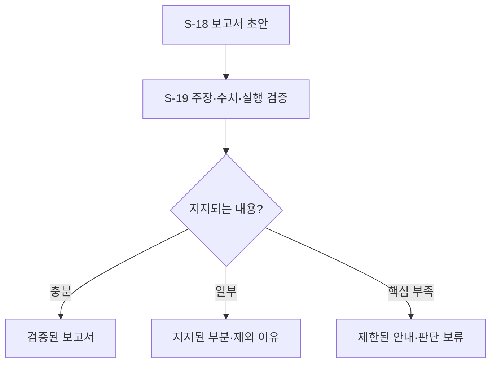

# B-07 · 근거 기반 보고서와 전달

[전체 계획](../01-overall-plan.md) · [상위 단계 목록](README.md)

## 1. 목적과 입출력

관측·제한·실제 조치·변화·다음 연습을 검증 가능한 보고서로 전달한다.

- 입력: `ReportRequest, EvidenceBundle, ReportPolicy`
- 출력: `VerifiedReport + 사용자 전달 상태`
- 이 문서의 책임: 세부 단계 호출 순서·조건부 분기·반복·종료 기준.

## 2. 실행 흐름

이 다이어그램의 `S-xx`만 Small Node다. 조건 마름모와 대기·결과 박스는 별도 노드 계층으로 세지 않는다. 다음 단계를 선택하는 주체는 상위 흐름과 하네스이며, Small Node가 다른 Small Node를 직접 호출하지 않는다.

## 3. 세부 단계와 산출물

| 순서 | Small Node | 단일 책임 | 산출물 |
| --- | --- | --- | --- |
| 1 | [S-18 · compose_grounded_report](../03-small-nodes/S-18.md) | 계산된 사실·불확실성·실제 개입·조건부 변화를 초보자가 이해할 수 있는 보고서로 구성한다. | ReportDraft |
| 2 | [S-19 · verify_and_deliver_report](../03-small-nodes/S-19.md) | 주장·수치·범위·실행 상태를 대조하고 지지된 내용만 사용자에게 전달한다. | VerifiedReport |

## 4. 분기와 중단·복구

| 조건 | 처리 |
| --- | --- |
| 충분한 관측·비교 | 근거 연결된 보고서 |
| 일부 주장 불일치 | 제한된 수정·삭제·부분 보고 |
| 모델 실패 | 검증 가능한 수치·상태 템플릿 사용 |
| 핵심 근거 부족 | 미확인 안내, 성적·향상 추정 금지 |

재시도는 [하네스·평가 계획](../06-harness-and-evaluation.md)의 공통 예산 안에서 수행한다. 사용자 취소, 세션 종료, 제어 epoch 변경을 무시하고 이전 작업을 계속하지 않는다.

## 5. 보존할 불변 조건

- 설명 문장과 계산값을 구분한다.
- 실제 행동·관측·추천을 구분한다.
- 이미지 없는 모델로도 표·그래프가 있는 보고서를 만들 수 있다.

## 6. 사용자 경험 예시

사용자에게 오류가 몰린 구간, 실제 낮춘 템포, 해당 조건의 변화, 가림으로 제외된 구간, 다음 시도를 함께 보여준다.

UI의 표현과 서버 실행 상태가 일치하도록 관측·선택·적용 대기·적용 확인·재평가를 구분한다.

## 7. 확인할 시나리오

- 주장·숫자·명령 상태가 같은 근거로 추적된다.
- 한국어 가독성과 의미 타당성도 형식 검증과 별도로 평가한다.

세부 실패·입출력·함수 검증은 연결된 Small Node 계약을 기준으로 확인한다. 이 목록은 계획의 수용 기준이며 개발 진척을 표시하지 않는다.
