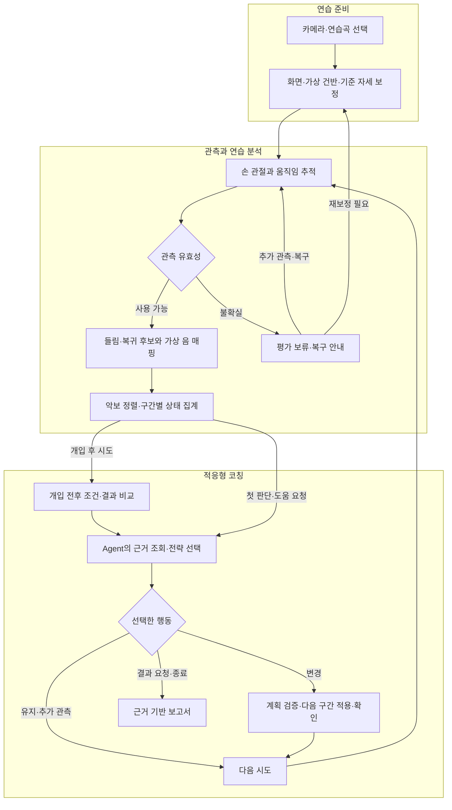

# pthoven

**Prometheus × Beethoven**

**Watch. Play. Adapt.**

[English](../README.md) | **한국어**

[Overview](#overview) · [Why pthoven?](#why-pthoven) · [Planned Capabilities](#planned-capabilities) · [Workflow](#workflow) · [CV Design](#cv-design) · [Agent Design](#agent-design) · [RoadMap](#roadmap)

> 카메라로 손가락 움직임을 관찰하고, Agent가 다음 연습을 조절하는 게임형 가상 피아노 코치.

이 README는 서비스의 목표와 개발 계획을 설명합니다.

**팀 테스트:** [CV 실험 웹 실행 가이드](../demo_test/experiment_web/README.md)에서 손가락 보정과 테스트 기록 수집을 시작할 수 있습니다. 실험 웹은 위의 서비스 계획과 구분하여 제공합니다.

## Overview

**pthoven(프토벤)**은 **Prometheus**와 **Beethoven**을 결합한 이름입니다. 일반 RGB 카메라와 책상 위 손가락 동작을 이용해 가상 피아노를 연주하고, **Computer Vision과 Practice Coach Agent**를 연결하여 사용자에게 맞는 다음 연습을 제공하는 프로젝트입니다.

사용자는 노트북에 표시되는 카메라 영상과 가상 건반을 보며 짧은 멜로디를 연습합니다. CV는 손가락 움직임과 관측 품질을 추출하고, Agent는 구간별 어려움과 이전 시도를 조회하여 템포·반복 구간·힌트를 조절합니다. 변경한 조건에서 다시 연습한 결과는 다음 코칭과 보고서의 근거가 됩니다.

핵심 목표는 **연주 결과를 다음 연습의 변화로 연결하는 것**입니다. 피아노에 관심은 있지만 악기와 연주 경험의 부족으로 시작을 망설이는 입문자가, 짧은 미션과 피드백을 통해 첫 연주를 경험하도록 돕고자 합니다.

## Why pthoven?

### 시작하기 위한 준비의 부담

악기와 별도 입력 장치를 준비해야 하는 부담은 가볍게 연주를 경험하고 싶은 입문자에게 장벽이 될 수 있습니다.

pthoven은 아이폰 연속성 카메라 또는 일반 웹캠으로 책상과 손을 촬영하고, 화면 위 가상 건반으로 연주하는 방식을 지향합니다. 사용자가 노트북 화면에서 안내와 손의 움직임을 함께 보며 시작할 수 있도록 설계합니다.

### 점수 이후에 필요한 다음 행동

틀린 음이나 점수를 확인하더라도, 어떤 구간을 얼마나 느리게 다시 연습해야 할지 스스로 결정하기는 어렵습니다.

Practice Coach Agent는 반복되는 어려움과 이전 개입의 결과를 조회하고, 다음 연습의 범위·템포·가이드 수준을 선택합니다. 피드백이 실제 연습 설정에 반영되고, 그 이후의 결과를 다시 확인하는 흐름을 목표로 합니다.

### 사용자마다 다른 연습 속도

같은 곡을 연습해도 어려운 구간과 필요한 준비 시간은 다를 수 있습니다. 정해진 속도로만 진행되는 콘텐츠는 이러한 차이에 대응하기 어렵습니다.

pthoven은 짧은 구간 반복과 조절 가능한 템포·힌트를 통해 사용자 상태에 맞는 연습을 구성하고, 안정적으로 수행하면 원래 목표 조건으로 돌아가는 과정을 설계합니다.

### 관측 실패와 연주 실수의 구분

손이 가려지거나 영상이 끊기면, 사용자가 수행한 동작을 카메라가 놓칠 수 있습니다. 이때 무입력을 곧바로 실수로 집계하면 피드백의 신뢰도가 낮아집니다.

pthoven은 관측이 불확실한 구간을 평가에서 분리하고, 필요한 경우 추가 관측이나 재보정을 요청합니다. Agent의 설명과 보고서에도 평가 가능한 결과와 확인되지 않은 부분을 함께 남깁니다.

## Planned Capabilities

| 기능 | 계획한 동작 |
| --- | --- |
| 카메라 기반 준비 | 사용자가 카메라를 선택하고 화면 방향·가상 건반·손가락 기준을 보정합니다. |
| 가상 피아노 게임 | 카메라 영상 위 가상 건반과 시각적 가이드를 통해 짧은 멜로디를 연습합니다. |
| 손가락 동작 입력 | 손가락의 들림·복귀 패턴과 손끝 위치를 결합해 가상 음 입력 후보를 만듭니다. |
| 관측 품질을 반영한 평가 | 가림·추적 손실·시간 공백을 구분하고, 평가 불가 구간을 사용자 오류에서 제외합니다. |
| 적응형 연습 코칭 | Agent가 근거와 이력을 조회하여 템포·반복 구간·힌트의 유지 또는 변경을 선택합니다. |
| 도구 실행과 적용 확인 | 변경 계획을 검증하고 약속한 시점에 적용한 뒤, 화면의 실제 적용 결과를 확인합니다. |
| 개입 결과 재평가 | 개입 전후의 설정과 관측 조건을 함께 비교하여 다음 연습을 결정합니다. |
| 근거 기반 연습 보고서 | 관찰 결과·불확실성·실제 조치·조건별 변화·다음 연습을 근거와 함께 설명합니다. |

## Workflow

CV는 프레임 단위로 동작하고, Agent는 구간 종료·반복되는 어려움·사용자 요청 같은 사건을 기준으로 호출합니다. 품질 악화 시 평가 보류는 모델 응답과 독립적으로 처리합니다. 변경한 설정은 다음 구간처럼 사용자가 이해할 수 있는 시점에 적용합니다.

## CV Design

### RGB 영상에서 손가락 움직임 관찰

기본 입력은 위에서 촬영한 일반 RGB 영상입니다. MediaPipe Hand Landmarker를 기반으로 손 관절과 손끝 위치를 추정하고, 사용자의 기준·들림 자세를 보정하여 손가락별 움직임을 분석합니다.

| 구성 | 설계 역할 |
| --- | --- |
| 손 관측 | 손 관절·이미지 좌표·관측 시각과 추적 상태를 추출합니다. |
| 좌표·자세 보정 | 영상·화면·가상 건반의 좌표를 일치시키고 손가락별 기준을 정의합니다. |
| 손가락 상태 머신 | 기준 자세 → 들림 → 복귀의 시간 순서를 확인하고 중복 입력을 억제합니다. |
| 가상 건반 매핑 | 동작 후보 시각의 손끝 위치를 가상 건반 영역에 연결합니다. |
| 관측 품질 평가 | 가림·손 연결 불확실성·보정 무효·시간 공백을 평가 보류 사유로 기록합니다. |

손가락 이름만으로 음을 정하지 않습니다. 같은 손가락도 위치에 따라 다른 가상 건반에 대응할 수 있으므로, 움직임과 공간 정보를 함께 사용합니다. 반전·화면 크기·영상 여백이 달라져도 같은 좌표 변환을 적용하도록 설계합니다.

### 동작 후보와 실제 접촉의 구분

단일 RGB 영상에서 추정한 3D 좌표는 책상 기준의 정밀한 물리 높이 측정값이 아닙니다. 들림·복귀 패턴이 관측되더라도 실제 접촉이 확인된 것은 아니므로, 이를 가상 입력의 잠정 근거로 다룹니다.

공중 탭·끌기·이웃 손가락 움직임·가림 등을 평가 시나리오에 포함하고, 독립적으로 검토한 정답과 비교합니다. 정밀도·재현율뿐 아니라 오입력·관측 가능 범위·보류율을 함께 확인합니다.

## Agent Design

### 구조화된 상태를 사용하는 Practice Coach

기본 Agent는 원본 영상 대신 **구간별 연습 지표, 관측 품질, 실제 설정, 이전 개입과 결과**를 입력받습니다. 필요한 정보가 부족하면 조회 도구를 사용하고, 허용된 범위 안에서 다음 연습을 선택합니다.

이미지 이해는 기본 코칭의 필수 조건이 아닙니다. 카메라 배치·잘림·가림을 설명하는 데 추가 가치가 확인되는 경우에만, 대표 프레임을 확인하는 선택 도구로 분리합니다.

### 조회·행동·재평가를 연결하는 도구

| 계획 도구 | 목적 |
| --- | --- |
| `get_practice_state` | 현재 판단에 사용할 스냅샷과 실제 설정을 확인합니다. |
| `get_segment_evidence` | 특정 구간의 입력·정렬·오류·평가 보류 근거를 조회합니다. |
| `get_tracking_summary` | 관측 누락·시간 공백·보정 문제를 확인합니다. |
| `get_attempt_history` | 이전 시도와 실제 개입 이력을 조회합니다. |
| `compare_attempts` | 두 시도의 조건과 비교 가능한 지표 변화를 확인합니다. |
| `get_reference_excerpt` | 기대 악보 구간과 지원되는 연습 기능을 확인합니다. |
| `set_tempo` / `set_practice_range` / `set_hint_level` | 다음 연습의 템포·반복 범위·시각적 가이드 변경을 준비합니다. |
| `request_recalibration` | 관측 기준을 다시 확보하는 절차를 요청합니다. |
| `pause_practice` / `resume_practice` / `finish_practice` | 사용자 의사와 유효 조건에 따라 연습 흐름을 제어합니다. |
| `inspect_visual_context` | 선택적으로 대표 프레임의 시각적 환경을 점검합니다. |

변경 도구 호출은 먼저 제안을 준비합니다. 계획의 근거·인자·현재 상태를 검증한 뒤 명령을 발행하고, UI의 실제 적용 응답을 받아 실행 결과를 확인합니다. Agent가 제안했다는 이유만으로 설정이 변경되었다고 기록하지 않습니다.

### 근거와 실행을 관리하는 하네스

하네스는 모델 호출 조건, 컨텍스트, 도구 범위, 실행 예산, 중복 방지, 적용 확인, 실패 처리와 기록을 관리합니다. CV·분석 코드가 계산한 수치를 사용하며, 모델이 관측 불확실성을 지우거나 판정 기준을 임의로 완화하지 못하도록 합니다.

개입 이후에는 같은 범위·템포·힌트·입력 출처인지 함께 비교합니다. 낮춘 템포에서 결과가 좋아졌다면 그 조건의 변화로 설명하고, 원래 속도에서의 향상 여부는 별도로 확인합니다. 보고서는 관찰·가설·실제 조치·추천을 구분하여 작성합니다.

## RoadMap

아래 단계는 의존성에 따른 개발 계획이며, 완료 현황이나 확정 일정은 표시하지 않습니다.

| 단계 | 목표 | 계획 산출물 |
| --- | --- | --- |
| 1. 계약·시나리오 정의 | 관측·입력·지표·명령의 의미와 평가 범위를 합의합니다. | 공통 데이터 계약, 시나리오·라벨 기준, 사용자 흐름 |
| 2. 카메라 상호작용 구성 | 카메라·손 추적·보정·가상 건반 매핑을 연결합니다. | 품질 정보가 포함된 손가락 동작·가상 음 입력 |
| 3. 연습 근거 구조화 | 기대 악보와 입력을 정렬하고 관측 불가 구간을 분리합니다. | 근거·분모·실제 설정이 연결된 연습 스냅샷 |
| 4. 도구·실행 제어 구성 | 조회·변경 제안·명령 적용·확인·실패 복구를 구성합니다. | 도구 계약, 상태 관리, 중복·지연·재연결 처리 |
| 5. 적응형 코칭 연결 | 모델의 조회·전략 선택·재평가·보고서를 연결합니다. | 텍스트 Agent, 개입 비교, 근거 기반 보고서 |
| 6. 평가·데모 준비 | 실제 촬영과 사용자 체험으로 입력·코칭·UI를 함께 평가합니다. | 실패 사례 분석, 재생 평가, 데모 시나리오와 개선안 |

모델과 실행 환경, 관측 정책, 개입 기준은 같은 조건의 비교 실험과 사용자 평가를 바탕으로 선택합니다.

상세 설계 문서: [팀 문서 안내](../docs/README.md).
